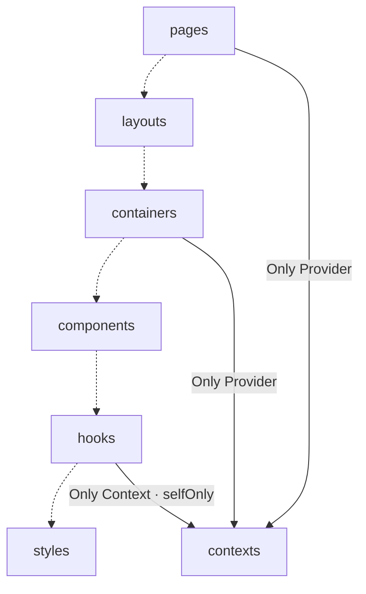

# cards — Architecture Handbook

> Generated from `blueprint.config` by `@kekkai/blueprint` — edit the blueprint, not this file.
Run `blueprint doctor --json` for the current-config adoption assessment; `blueprint inspect --json` supplies the architecture subset. Report executable gates, structural evidence (including baselined debt and non-blocking violations), reach, and semantic review separately. Green checks do not prove module ownership, layer placement, root responsibility, presentation responsibility, or topology correctness. Read `assessment`; `gateVerdict` is gate-only and `verdict` is its deprecated 4.2 alias. `ok` retains exit compatibility, so exit 0 does not mean all evidence was verified. Review module/layer/root responsibility explicitly; consumer counts are review signals, not proof of neutral ownership. A deliberate empty-module runway is declaratory. Current-config gates cannot discharge historical transformation or lifecycle obligations. These generated instructions contain no live assessment; rerun the commands against current source.

## Architecture

Code flows one way: each layer may import only from the layers below it. Upstream imports and same-layer imports through the alias are barred.

> **How to read the diagram**: a **solid** edge is a declared importer relation (its label carries the description and/or `selfOnly` — depend on it, never re-export it). A **dotted** edge only records declaration order: adjacent layers are not necessarily related. Reachability is transitive — a layer may import **any** layer below it in the flow, whether or not an edge is drawn, unless the target narrows its importers (`allowedImporters`).

### Layers

| Layer | Responsibility | Must not | Owns |
| --- | --- | --- | --- |
| `pages` | Route-level scenes plus the route table — composes a layout and containers into one screen. | — | `react-router` |
| `layouts` | Persistent page frame — chrome and outlet placement shared across routes. | — | `react-router` |
| `containers` | Interaction stages — owns card state and orchestrates one animation scene. | — | `react-router` |
| `components` | Presentational card and UI units driven entirely by props. | — | — |
| `hooks` | Reusable behaviour and state — shuffling, spreading, drawing, breakpoints, fingerprinting. | — | `react` → `useContext`, `react-router`, `zustand` |
| `styles` | styled-components primitives, the icon set and the global stylesheet. | — | `react-router` |
| `contexts` | React context definitions shared across the tree. | — | `react` → `createContext`, `react-router` |

## Unit shape

A unit is the code item inside a layer. Folder units expose only their entry; file units are one file each.

| Layer | Unit layout | Entry |
| --- | --- | --- |
| `pages` | `folder` | `index` |
| `layouts` | `folder` | `index` |
| `containers` | `folder` | `index` |
| `components` | `folder` | `index` |
| `hooks` | `folder` | `index` |
| `styles` | `folder` | `index` |
| `contexts` | `folder` | `index` |

## Import discipline

These boundaries are verified alive in the project ESLint run — one blueprint drives both:

- **One-way only** — a layer imports only from the layers below it; upstream imports are errors.
- **Canonical boundary spelling** — use `~app`, the source-root alias, whenever an import crosses a declared layer or module boundary. Additional aliases are resolved for diagnosis, but rejected as alternate boundary spellings.
- **No same-layer imports via the alias** — use a relative path. File units may reach sibling files; folder units may reach a sibling only through its entry. Extract shared logic down to a lower layer when neither unit owns it.
- **Entry-only** — import a folder unit through its `index`, never its internals.
- **Dynamic parity** — a dynamic import whose target reduces to a proven string follows the same alias, flow, and unit-entry rules. Runtime-dependent targets remain explicitly unverified; they are never invented as legal graph dependencies.
- **No redundant relative segments** (`./../`, `././`) that bypass the rules.
- **Ownership** — packages and globals are restricted to their owning layer (see the *Owns* column above).
- **selfOnly** — where a layer narrows its importers with `selfOnly`, that importer may depend on it but must never re-export it onward.

## Principles

### Enforced by tooling

- **A folder may only import modules that lie downstream along the flow; upstream and reverse imports are not allowed.** — The layer order is the architecture. Once imports may point either way, every folder is reachable from every other and the boundaries stop meaning anything.

## Rules

| Rule | Tier | Option | Enforced by |
| --- | --- | --- | --- |
| `cycles` | `error` | — | `blueprint inspect` |
| `unusedVars` | `error` | — | lint |
| `explicitAny` | `error` | — | lint |
| `importBlock` | `error` | — | lint |
| `statementPadding` | `error` | — | lint |
| `codeStyle` | `error` | — | lint |
| `maxLines` | `error` | — | lint |
| `maxLinesPerFunction` | `error` | — | lint |
| `maxParams` | `error` | — | lint |
| `maxStatements` | `error` | — | lint |
| `complexity` | `error` | — | lint |
| `testFilename` | `error` | — | lint |

The tier is what the enforcing machine does with a violation: `error` fails, `warn` is advisory, `off` is disabled. Which machine differs — `lint` rows fail the project's lint run, `blueprint inspect` rows fail `blueprint inspect` and never appear in a lint run, documentation-only rows are recorded intent with no gate behind them at any tier, and a row reading `nothing` is lint-gated in general but cannot emit on THIS blueprint — the cell says which fact rules it out. Every row reaches only the files the architecture globs match: a declared position holding no code has nothing that can fail, which is runway rather than protection — `blueprint doctor` reports which of the two this repo has today.

## Naming

| Concept | Convention |
| --- | --- |
| `module` | PascalCase folder with an index entry, e.g. contexts/PortalMount/index.ts |
| `hook` | useX folder under hooks/, e.g. hooks/useShuffleCards |
